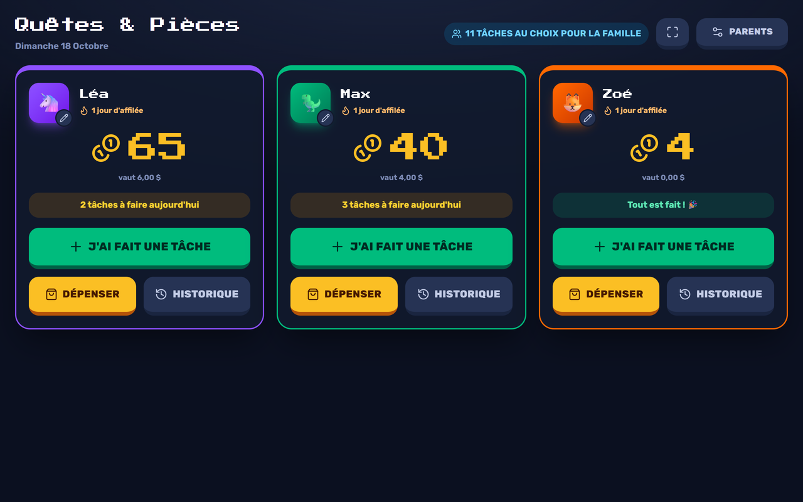
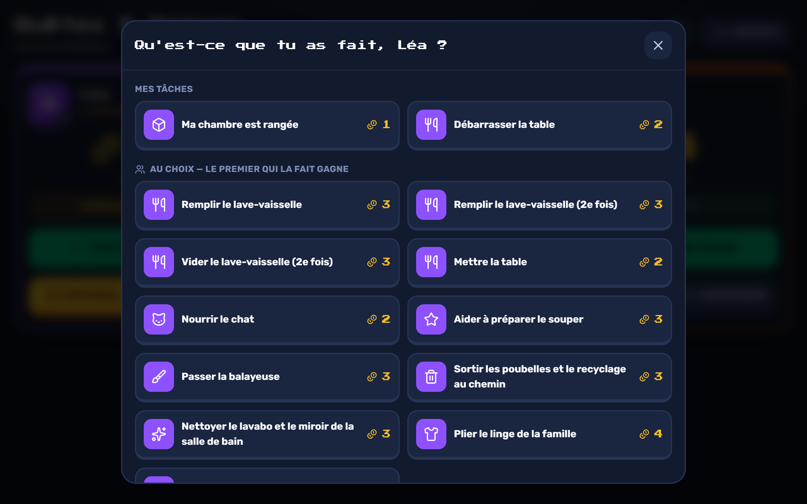
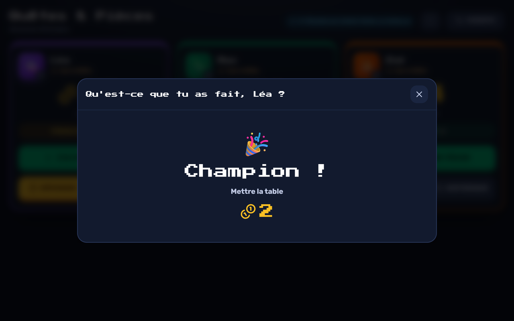
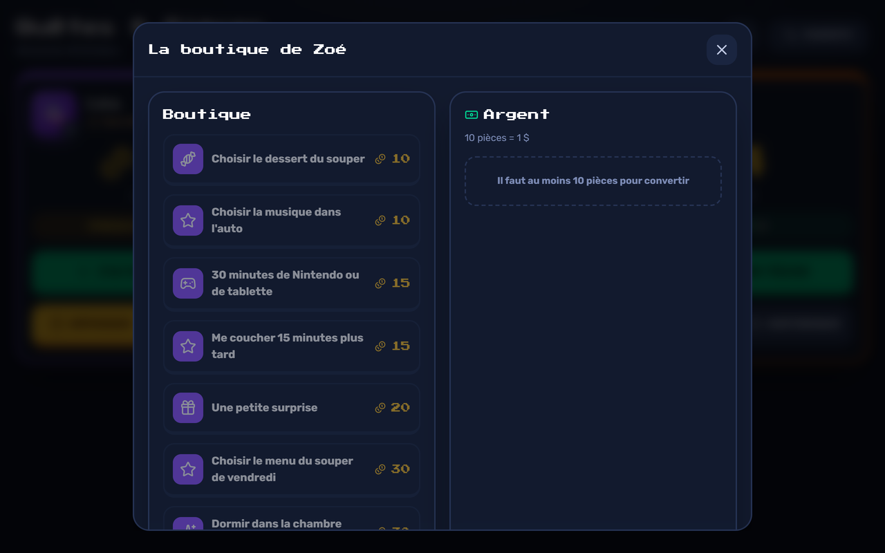
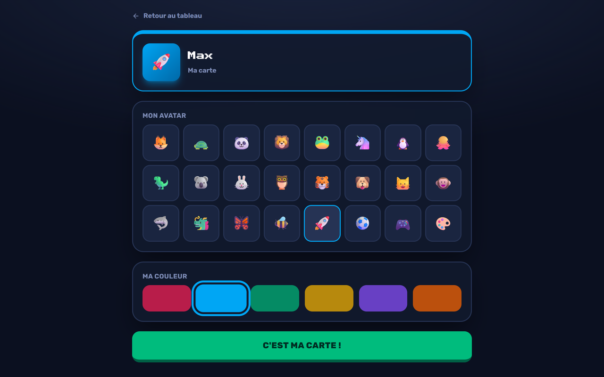
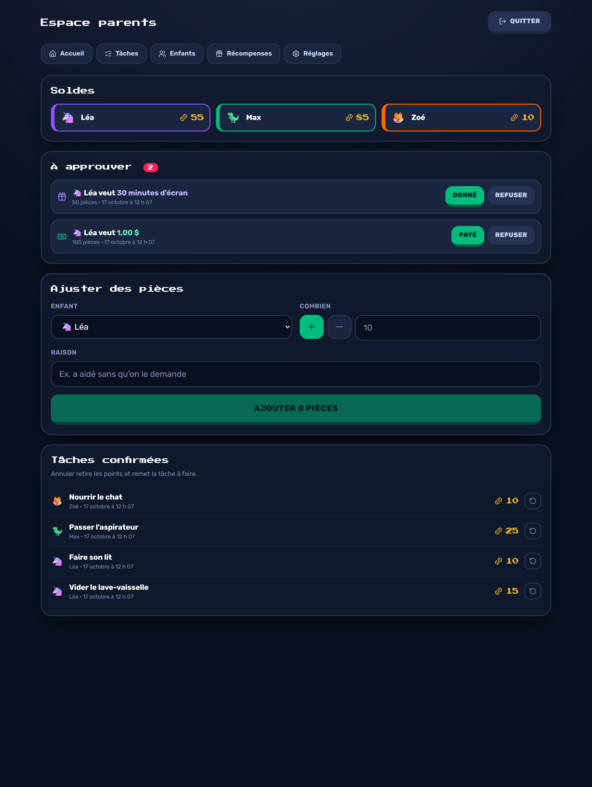
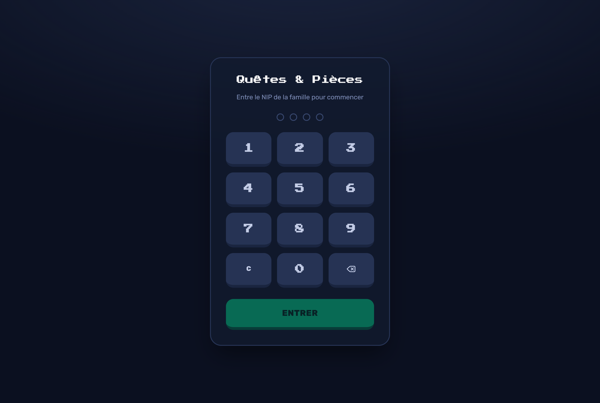

<p align="center"></p>

# Quêtes & Pièces

Application de tâches et de points pour les enfants, à héberger à la maison.
Les enfants confirment eux-mêmes leurs tâches sur un écran partagé, gagnent des
« pièces », et les échangent contre des récompenses ou de l'argent réel.

Empaquetée comme **add-on Home Assistant**, mais accessible directement par une
URL locale (`http://<ip-ha>:3000`) sans passer par Home Assistant — pas de
panneau dans la barre latérale, c'est un NIP qui protège l'accès.



## Ce que ça fait

- **Tableau de bord familial** — une carte par enfant: son solde, sa série de
  jours consécutifs, le nombre de tâches qui lui restent, et trois boutons
  (*J'ai fait une tâche*, *Dépenser*, *Historique*). Les cartes s'ajustent à
  l'écran: trois côte à côte sur une tablette à l'horizontale, sans défiler.
- **Confirmer une tâche** — une fenêtre liste ce que l'enfant peut confirmer.
  Un tap affiche un « Bravo ! » et les pièces s'envolent vers son solde.
- **Deux sortes de tâches** — *individuelles* (assignées à un enfant, comptées
  sur sa carte) et *familiales* (au choix: la première personne qui la fait
  gagne les pièces; leur nombre s'affiche en haut du tableau).
- **Récurrences** — tous les jours, certains jours de la semaine, une fois par
  semaine, ou une seule fois. Aucune tâche à réinitialiser à la main.
- **Confiance par défaut** — confirmer une tâche crédite les pièces tout de
  suite; un parent peut annuler après coup.
- **Boutique et argent** — récompenses achetables en pièces, et conversion en
  dollars au taux de votre choix. Les deux passent par une approbation parent.
- **Ma carte** — chaque enfant choisit lui-même son avatar et sa couleur.
- **Installable** — l'app se pose sur l'écran d'accueil d'une tablette et
  s'ouvre en plein écran (voir *Installer sur une tablette*).
- **Espace parents** — protégé par un second NIP: tâches, enfants, récompenses,
  ajustements manuels, approbations et réglages.

### En images

| | |
|---|---|
|  |  |
| **J'ai fait une tâche** — ses tâches d'abord, puis celles au choix pour la famille. | **Bravo !** — puis les pièces volent jusqu'au solde. |
|  |  |
| **Dépenser** — récompenses et conversion en argent, approuvées par un parent. | **Ma carte** — l'enfant choisit son avatar et sa couleur. |
|  |  |
| **Espace parents** — soldes, demandes à approuver, ajustements manuels et annulation d'une tâche confirmée. | **NIP d'entrée** — un pavé numérique, pensé pour une tablette au mur. |

<p align="center">
  
</p>

## Installer sur une tablette

L'app a un manifeste d'application web: un navigateur peut l'installer comme
une vraie application, avec son icône dans le menu, et elle s'ouvre alors en
plein écran.

**Les navigateurs n'installent une application que depuis une adresse sûre**
(HTTPS, ou `localhost`). Servie en HTTP sur le réseau local
(`http://<ip-ha>:3000`), Chrome refuse l'installation. Deux façons de faire:

- **Sur la tablette de la maison (le plus simple)** — dans Chrome, ouvrir
  `chrome://flags/#unsafely-treat-insecure-origin-as-secure`, y inscrire
  `http://<ip-ha>:3000`, activer, relancer Chrome. Ouvrir l'app, puis
  *⋮ → Installer l'application*. Le réglage ne vaut que pour cette adresse et
  ce navigateur.
- **Pour tous les appareils** — servir l'app en HTTPS, par exemple derrière le
  proxy NGINX de Home Assistant avec un certificat.

Sans installation, le bouton ⛶ du tableau de bord passe en plein écran.

## Comment c'est construit

Next.js 16 (App Router) · Prisma 7 · SQLite · Tailwind v4 · TypeScript.

Quelques décisions qui expliquent le reste du code :

- **Le solde n'est jamais stocké.** Toute variation de pièces est une ligne
  dans la table `Transaction`, en ajout seulement, et un solde est toujours une
  somme. Annuler une tâche n'efface pas le gain: ça ajoute une écriture
  inverse. Sur un sujet qui finit en argent réel, l'historique doit rester
  vérifiable.
- **Les occurrences ne sont pas générées à l'avance.** Une tâche a une
  `periodKey` calculée à l'affichage (le jour, la semaine ISO…). Quand la
  période change, la clé change et la tâche redevient disponible — sans cron ni
  job de réinitialisation.
- **La course est arbitrée par la base.** Deux enfants qui tapent la même tâche
  familiale en même temps sont départagés par une contrainte unique
  `(taskId, periodKey)`, pas par une vérification préalable. C'est la seule
  façon fiable de trancher deux clics simultanés.
- **Les journées sont calculées dans le fuseau de la famille**, pas en UTC:
  sinon une tâche confirmée à 20 h compterait pour le lendemain.

## Développement

```bash
cd taches-et-points
npm install
npx prisma migrate deploy
npm run dev
```

Il faut un fichier `.env` avec au minimum `DATABASE_URL` et `SESSION_SECRET`
(voir le tableau plus bas).

Ouvrir http://localhost:3000 — au premier lancement, l'application demande de
choisir les deux NIP.

Pour repartir d'un jeu de données d'exemple (deux enfants, des tâches, des
récompenses) :

```bash
npm run db:seed             # NIP 1234 (entrée) et 9999 (parent)
```

### Tests

```bash
npm test
```

Les tests tournent contre une vraie base SQLite jetable et couvrent ce qui doit
absolument être correct: l'arbitrage des tâches familiales (y compris deux
confirmations vraiment simultanées), l'annulation par un parent, le calcul des
récurrences et leur changement en cours de route, l'impossibilité de dépenser
deux fois les mêmes pièces, les doubles clics d'un parent (un refus ne
rembourse qu'une fois), l'enfant désactivé, et le frein du NIP face à une
rafale de tentatives.

### Après un `npm install` sous Windows ou macOS

Régénérer le lockfile dans un conteneur Linux :

```bash
docker run --rm -v "$PWD:/app" -w /app node:24-bookworm-slim \
  npm install --package-lock-only --ignore-scripts
```

npm n'inscrit dans `package-lock.json` que les dépendances optionnelles de la
plateforme courante. Un lockfile produit sous Windows n'a donc pas les binaires
natifs Linux (ceux de Tailwind, notamment), et le `npm ci` de l'image Docker
échoue avec « package.json and package-lock.json are not in sync ».

### Variables d'environnement

| Variable | Rôle |
|---|---|
| `DATABASE_URL` | Fichier SQLite, ex. `file:./dev.db` |
| `SESSION_SECRET` | Clé de signature des sessions, 32 caractères minimum |
| `APP_TIMEZONE` | Fuseau pour le calcul des journées (défaut `America/Toronto`) |

Générer un secret :

```bash
node -e "console.log(require('crypto').randomBytes(48).toString('hex'))"
```

Dans l'add-on, ces trois variables sont gérées automatiquement par `run.sh`.

## Installation comme add-on Home Assistant

1. Dans Home Assistant : **Paramètres → Modules complémentaires → Boutique →
   ⋮ → Dépôts**, ajouter l'URL de ce dépôt Git.
2. Installer **Quêtes & Pièces** dans la liste, puis démarrer.
3. Ouvrir `http://<ip-de-home-assistant>:3000` et choisir les deux NIP.

Option de l'add-on : `timezone` (fuseau de la famille, au format
`America/Montreal`). Un fuseau inconnu est ignoré au profit de
`America/Toronto`, avec un avertissement dans le journal de l'add-on.

La fiche de l'add-on dans Home Assistant (onglet Documentation) vient de
`taches-et-points/DOCS.md`, écrite pour un parent. L'icône et le logo de la
boutique sont `icon.png` et `logo.png` dans le même dossier.

Pour construire et essayer l'image sans Home Assistant :

```bash
cd taches-et-points
docker build --build-arg BUILD_FROM=node:24-bookworm-slim -t taches-et-points .
docker run -d -v tepdata:/data -p 3000:3000 taches-et-points
```

### Publication des images

Le Supervisor **télécharge** l'image, il ne la construit pas: `config.yaml`
porte une clé `image:`, et compiler Next.js sur le matériel Home Assistant
serait long (très long sur un Raspberry Pi).

Les images sont produites par `.github/workflows/publier-addon.yml` vers
`ghcr.io/poupouproject/taches-et-points-{arch}`. Chaque architecture est
construite sur un runner de la même architecture: émuler l'ARM en QEMU
multiplierait la durée du build. Avant toute publication, l'image est démarrée
et doit répondre; une image qui ne démarre pas n'atteint jamais GHCR. Sur une
pull request, l'image est construite et testée, sans être publiée.

**Un tag de version publié ne se réécrit jamais.** Si `main` reçoit du code
sans que la version de `config.yaml` change, rien n'est poussé: les
installations existantes recevraient sinon d'autres binaires sans que Home
Assistant affiche de mise à jour.

**Pour livrer une mise à jour**, le versionnage passe par
[Changesets](https://github.com/changesets/changesets) :

1. Chaque branche décrit son changement :

   ```bash
   cd taches-et-points
   npx changeset       # décrire le changement, choisir patch / minor / major
   ```

   et committe le fichier créé dans `.changeset/` avec le reste.
2. À la fusion sur `main`, `.github/workflows/versionner-addon.yml` ouvre (ou
   met à jour) une pull request **« Version de l'add-on »**. Elle applique les
   changesets en attente: nouvelle version dans `package.json` et
   `config.yaml`, nouvelles entrées dans `CHANGELOG.md`.
3. **Fusionner cette pull request publie la version**: le push qui en résulte
   porte un nouveau numéro dans `config.yaml`, les images sont poussées sous ce
   tag, et Home Assistant propose la mise à jour.

`npm run version` fait la même chose à la main, si besoin.

**Toute branche qui touche à `taches-et-points/` doit ajouter un changeset**, et
la CI le vérifie (seule la pull request de version en est dispensée). Ce n'est pas de la bureaucratie: le texte du changeset devient
une entrée de `taches-et-points/CHANGELOG.md`, que Home Assistant affiche sur la
page de l'add-on. C'est ce qu'un parent lit pour décider s'il met à jour, donc
l'entrée se rédige dans ses mots — voir `taches-et-points/.changeset/README.md`.
Pour un changement sans effet visible: `npx changeset add --empty`.

`config.yaml` est le seul numéro que le Supervisor lit (c'est le tag GHCR
publié, et ce qui déclenche le bouton « Mettre à jour »). `npm run version` le
tient synchronisé avec `package.json`, il n'y a donc qu'un numéro à gérer.

**Réglages du dépôt GitHub** nécessaires :

- *Settings → Actions → General → Workflow permissions* : cocher **« Allow
  GitHub Actions to create and approve pull requests »**, sans quoi la pull
  request de version ne peut pas être ouverte.
- *Settings → Branches* (dépôt public ou GitHub Pro) : protéger `main` en
  exigeant le contrôle **« Un changeset accompagne la branche »** et les deux
  builds `amd64` / `aarch64`.

**Au tout premier passage**, rendre les deux paquets GHCR publics (Profil
GitHub → Packages → `taches-et-points-amd64` puis `-aarch64` → Package settings
→ Change visibility → Public). Sans ça, Home Assistant ne peut pas les
télécharger: il n'est pas authentifié auprès de GHCR.

À savoir :

- **Le dépôt doit être public.** Le Supervisor n'a pas de support propre pour un
  dépôt GitHub privé comme boutique d'add-ons.
- **Pas d'ingress, port direct.** L'add-on expose le port 3000 et n'apparaît pas
  dans la barre latérale: c'est voulu, et c'est le NIP qui protège l'accès.
  Comme l'application est servie en HTTP sur le réseau local, ne l'exposez pas
  sur Internet telle quelle.
- **Les données vivent dans `/data`**, le dossier persistant de l'add-on: elles
  survivent aux redémarrages et aux mises à jour, et sont incluses dans les
  sauvegardes Home Assistant. Le secret de session y est généré une fois puis
  conservé, pour ne pas déconnecter tout le monde à chaque mise à jour.

## Structure

```
repository.yaml            Déclare le dépôt comme boutique d'add-ons HA
.github/workflows/         Publication des images, PR de version, contrôle du changeset
docs/captures/             Captures d'écran du README
taches-et-points/          L'add-on (= le contexte de build Docker)
  config.yaml              Manifeste: port direct, pas d'ingress, /data
  DOCS.md                  Fiche « Documentation » de l'add-on dans Home Assistant
  icon.png, logo.png       Icône et logo de la boutique d'applications
  build.yaml               Images de base par architecture
  Dockerfile               Build Next.js multi-étapes
  run.sh                   Démarrage: fuseau, secret, migrations, serveur
  prisma/schema.prisma     Modèle de données
  public/icons/            Icônes de l'app installée sur une tablette
  src/lib/                 Logique métier (ledger, récurrences, session)
  src/app/                 Pages et Server Actions
  tests/                   Tests de la logique métier
```

L'application vit dans le sous-dossier `taches-et-points/` parce que le
Supervisor construit chaque add-on en utilisant **son propre dossier** comme
contexte Docker.
